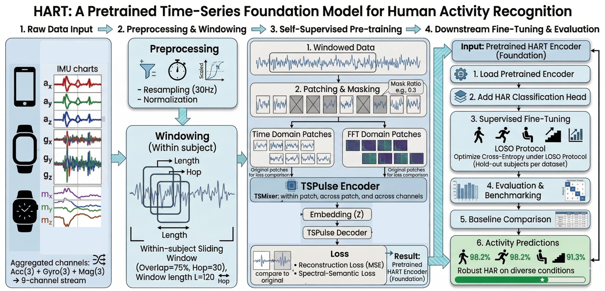

# Contextualization-Aware Adapter Placement for Sampling-Rate Transfer in Wearable HAR

**Kavya Kalavala and Mahadevi S**, Manipal Institute of Technology Bengaluru. Presented at CIMA 2026.

Resampling restores the nominal input size of a wearable signal but cannot recover information lost when a sensor
records at a lower rate. This study asks where lightweight adapters should sit relative to HART's frozen
time-frequency contextualizer to recover performance under sampling-rate shift: rank-8 residual adapters are inserted
upstream or downstream of the contextualizer under an equal parameter budget, with paired-view representation learning.

**This repository extends the official HART code** ([EdgeIntelligenceLab/HART](https://github.com/EdgeIntelligenceLab/HART),
MIT licence, Jare et al., FMSys'26), which in turn adapts IBM Granite TSPulse. Our additions:

- `experiments/rate_adaptation/`, `experiments/rate_reliability/`: adapter-placement and sampling-rate reliability experiments
- `outputs_rate_adaptation/`: pilot, controlled and multi-seed replication results

Raw HAR datasets, pretrained checkpoints and the vendored TSPulse package are not redistributed; follow the original
HART instructions below to obtain them. The original HART README follows unchanged.

---

# HART: A Pretrained Time-Series Foundation Model and Benchmark for Human Activity Recognition

This repository contains the official code, pretrained checkpoint, evaluation scripts, and additional experiment artifacts for the paper:

**HART: A Pretrained Time-Series Foundation Model and Benchmark for Human Activity Recognition**

Accepted at **The 3rd International Workshop on Foundation Models for Cyber-Physical Systems and Internet of Things (FMSys'26)**, co-located with **CPS-IoT Week 2026**.

- Workshop venue: Lamenais 3, Level 3, Palais des Congrès de Saint Malo, Saint-Malo, France
- Workshop date: 11 May 2026
- Workshop page: https://fmsys-org.github.io/2026/
- ACM Digital Library: link will be added after the proceedings page is live
- Upstream TSPulse codebase: https://github.com/ibm-granite/granite-tsfm



## Abstract

Human Activity Recognition (HAR) data, collected at high temporal resolutions from diverse wearable sensors and sensing environments, provide a rich basis for understanding human motion patterns and behavioral dynamics. Conventional HAR models are often trained separately on individual datasets, which limits their generalization across users, devices, and sensing conditions.

HART is a lightweight HAR-specialized pretrained time-series model based on the TSPulse architecture. It is pretrained on 26 public HAR datasets spanning accelerometer, gyroscope, and magnetometer signals, comprising approximately 0.46 billion standardized sensor data points. By combining HAR-specific pretraining with standardized multi-dataset harmonization, HART learns reusable representations for wearable sensing under heterogeneous real-world conditions.

We evaluate HART on multiple HAR datasets under in-distribution (ID) and out-of-distribution (OOD) settings using a Leave-One-Subject-Out (LOSO) protocol, and compare it with classical machine learning models, general-purpose Time-Series Foundation Models (TSFMs), and HAR-specific baselines. HART achieves the best aggregate ID performance and competitive OOD performance while maintaining a compact model footprint.

## Key Contributions

1. **HAR-specialized pretraining at scale.** HART is pretrained on 26 standardized public HAR datasets with 23,930 sessions, 507 subjects, and 456,588,855 sensor data points across accelerometer, gyroscope, and magnetometer modalities.
2. **TSPulse adaptation for wearable sensing.** HART adopts IBM Granite TSPulse and adapts its lightweight dual-domain time/frequency masked reconstruction design to human motion signals.
3. **Standardized multi-dataset harmonization.** The repository implements preprocessing and 30 Hz polyphase resampling to reduce format and sampling-rate mismatch across heterogeneous HAR datasets.
4. **Unified ID/OOD LOSO benchmark.** HART is evaluated on 14 IMU-based HAR datasets using a consistent Leave-One-Subject-Out protocol against classical classifiers, general TSFMs, and HAR-specific baselines.
5. **Open reproducibility package.** The repository releases pretraining, finetuning, benchmarking scripts, a pretrained HART checkpoint, and additional compression/deployment experiments.

## Method Overview

HART follows a four-stage workflow:

1. **Dataset harmonization:** raw HAR datasets are standardized using the WHAR preprocessing pipeline, cleaned, label-normalized, and organized by subject/session.
2. **30 Hz resampling:** each IMU stream is resampled to 30 Hz using polyphase resampling with an anti-aliasing FIR filter. This keeps temporal and spectral structure comparable across datasets.
3. **Self-supervised pretraining:** HART uses the TSPulse dual-domain backbone with time-domain patches, FFT-domain patches, register tokens, block masking, patch-wise reconstruction, and a frequency-signature objective.
4. **LOSO finetuning and benchmarking:** the pretrained model is adapted to each downstream HAR dataset with a classification head and evaluated with Leave-One-Subject-Out folds.

The final HART configuration uses a 120-sample context window, corresponding to 4 seconds at 30 Hz, with `d_model=48`, 8 encoder blocks, 2 decoder blocks, patch length/stride 12, and 5 register tokens. The compact L=120 model has 206,860 trainable parameters before downstream adaptation.

## Repository Layout

```text
HART/
├── README.md
├── CITATION.md
├── LICENSE
├── environment.yml
├── configs/
│   └── hart_config_L120_d48.json
├── data_preprocessing/
│   ├── whar_preprocessor.py
│   └── Resampling.py
├── pretraining_HART/
│   ├── config_clf.json
│   └── pretrain.py
├── finetuning_HART/
│   ├── pretrained_checkpoint/
│   │   ├── config.json
│   │   ├── model.safetensors
│   │   └── training_args.bin
│   ├── HAR_dataloader.py
│   ├── finetune.py
│   └── run_all.sh
├── benchmarking/
│   ├── ml_models/
│   ├── HAR_models/
│   └── TSFMs/
├── checkpoints/
│   └── pretrained_hart_L120_d48/
├── experiments/
│   ├── branch_pruning/
│   ├── gradient_pruning/
│   ├── quantization/
│   ├── results_summary/
│   ├── rpi_deployment/
│   └── rpi_metrics/
└── figures/
    └── proposed_methodology-clean.png
```

## Environment

Create the conda environment:

```bash
conda env create -f environment.yml
conda activate <env_name>
```

## Datasets

The primary dataset source is the WHAR-datasets project:

- https://github.com/teco-kit/whar-datasets

This repository does not redistribute raw HAR datasets. Download the datasets through WHAR and the original dataset-owner links referenced there. Keep raw downloads separate from generated 30 Hz files so preprocessing can be repeated cleanly.

Recommended local layout:

```text
datasets/
├── raw/
│   ├── <dataset_1>/
│   ├── <dataset_2>/
│   └── ...
├── whar_processed/
│   ├── <dataset_1>/
│   ├── <dataset_2>/
│   └── ...
├── pretrain_30hz/
│   ├── <dataset_1>/
│   ├── <dataset_2>/
│   └── ...
└── test_set/
    ├── <dataset>_30Hz_test.csv
    └── ...
```

Use the directories as follows:

| Directory | Purpose | Used by |
| --- | --- | --- |
| `datasets/raw/` | Original dataset downloads from WHAR or dataset owners | WHAR preprocessing |
| `datasets/whar_processed/` | Intermediate WHAR-standardized files | Resampling |
| `datasets/pretrain_30hz/` | 30 Hz CSVs used for HART pretraining | `pretraining_HART/pretrain.py` |
| `datasets/test_set/` | Prepared LOSO/evaluation CSVs | `finetuning_HART/finetune.py` and baselines |

The paper pretraining corpus contains the following 26 datasets: DAPHNET, DSADS, FallDet, GOTOV, HangTime, HAR70+, HARSense, HUGADB, KU-HAR, MHEALTH, MotionSense, PAMAP2, RealLifeHAR, RealWorld, SAD, UCA-EHAR, UCI-HAR, UMA-Fall, UP-Fall, USC-HAD, UTD-MHAD, W-HAR, WEAR, WISDM-19 Phone, WISDM-19 Watch, and WISDM.

## Preprocessing

Run WHAR preprocessing first, then resample to 30 Hz:

```bash
python data_preprocessing/whar_preprocessor.py

python data_preprocessing/Resampling.py \
    --input_dir /path/to/whar_processed \
    --output_dir /path/to/pretrain_30hz \
    --target_fs 30
```

All pretraining and evaluation data should use the same 30 Hz representation. This is important because HART uses both time-domain and frequency-domain representations, and inconsistent sampling rates can shift FFT-domain structure across datasets.

## Pretraining

Before pretraining, set the data and output paths in `pretraining_HART/pretrain.py`:

```python
args.data_root_path = "/path/to/datasets/pretrain_30hz"
args.save_dir = "/path/to/save/checkpoints"
```

Launch distributed pretraining with `torchrun`:

```bash
torchrun --nproc_per_node=<NUM_GPUS> pretraining_HART/pretrain.py
```

The paper configuration uses:

| Setting | Value |
| --- | --- |
| Hardware | 2 x RTX 5090, 32 GB |
| Precision | bf16 |
| Batch size | 4096 per GPU |
| Optimizer | AdamW, weight decay 0.01 |
| Epochs | 40 |
| Context length | 120 |
| Encoder / decoder blocks | 8 / 2 |
| `d_model` | 48 |
| Patch length / stride | 12 / 12 |
| Register tokens | 5 |
| Masking | block masking, ratio 0.3 |
| Auxiliary objective | log-spectrum frequency signature |

## Finetuning and Evaluation

The repository provides a pretrained HART checkpoint in:

```text
finetuning_HART/pretrained_checkpoint/
```

To evaluate a single dataset:

```bash
python finetuning_HART/finetune.py \
    --dataset_name capture24 \
    --checkpoint_path finetuning_HART/pretrained_checkpoint \
    --device cuda:0 \
    --context_length 120 \
    --hop_length 30 \
    --epochs 100 \
    --patience 15 \
    --test_set_dir /path/to/datasets/test_set \
    --output_dir results
```

To run the batch evaluation script:

```bash
bash finetuning_HART/run_all.sh \
    finetuning_HART/pretrained_checkpoint \
    cuda:0 \
    100 \
    30 \
    <conda_env_name> \
    /path/to/datasets/test_set \
    120
```

Evaluation uses strict Leave-One-Subject-Out folds. For each fold, one subject is held out for testing and the remaining subjects are used for development. HART is adapted by attaching a gated-attention pooling classification head and finetuning the encoder plus head.

## Baselines

The repository includes three baseline groups under `benchmarking/`:

- `benchmarking/ml_models/`: classical time-series classifiers including KNN, Arsenal, Rocket/MiniRocket, and a naive baseline.
- `benchmarking/HAR_models/`: HAR-specific deep learning baselines including HARNet and TinyHAR.
- `benchmarking/TSFMs/`: general-purpose time-series foundation model baselines including MOMENT, UniTS, and TSPulse.

All baselines should be evaluated under the same 30 Hz preprocessing and LOSO protocol used for HART.

## Main Results

HART is evaluated on 14 IMU-based HAR datasets: 8 in-distribution datasets where subject-level data from the same dataset family appears during pretraining, and 6 out-of-distribution datasets fully held out from pretraining.

### Aggregate ID Results

| Model | Acc. | Prec. | Rec. | F1 |
| --- | ---: | ---: | ---: | ---: |
| Naive | 0.1876 | 0.1858 | 0.1863 | 0.1730 |
| KNN | 0.4550 | 0.3675 | 0.3838 | 0.3202 |
| Arsenal | 0.7441 | 0.7007 | 0.6959 | 0.6744 |
| Rocket | 0.7342 | 0.7017 | 0.6924 | 0.6717 |
| TinyHAR | 0.7465 | 0.6512 | 0.6768 | 0.6428 |
| UniTS | 0.6234 | 0.5534 | 0.5365 | 0.5099 |
| MOMENT | 0.6746 | 0.6329 | 0.6338 | 0.5964 |
| TSPulse | 0.7134 | 0.6467 | 0.6183 | 0.6051 |
| HARNet | 0.5960 | 0.5129 | 0.5090 | 0.4632 |
| **HART** | **0.7529** | **0.7320** | **0.7009** | **0.6803** |

### Aggregate OOD Results

| Model | Acc. | Prec. | Rec. | F1 |
| --- | ---: | ---: | ---: | ---: |
| Naive | 0.1803 | 0.1784 | 0.1986 | 0.1570 |
| KNN | 0.4988 | 0.3447 | 0.3368 | 0.2929 |
| Arsenal | 0.7103 | 0.5917 | 0.5394 | 0.5249 |
| Rocket | 0.6915 | 0.5720 | 0.5246 | 0.5096 |
| TinyHAR | 0.7210 | 0.6209 | 0.5984 | 0.5683 |
| UniTS | 0.6229 | 0.4346 | 0.4449 | 0.4159 |
| MOMENT | 0.6255 | 0.5164 | 0.5283 | 0.4497 |
| TSPulse | 0.5885 | 0.3659 | 0.3675 | 0.3503 |
| HARNet | 0.6900 | 0.5073 | 0.5056 | 0.4841 |
| **HART** | **0.7491** | 0.6199 | 0.5782 | 0.5656 |

These results show that HAR-aligned pretraining improves substantially over the base TSPulse transfer setting, especially in OOD accuracy and F1. HART achieves the best aggregate ID performance and competitive OOD performance while using a compact pretrained initialization rather than training a separate full model from scratch for every dataset.

## Additional Experiments

In addition to the paper benchmark, this repository includes extra experiments on compression and edge-oriented deployment:

- `experiments/quantization/`: post-training dynamic INT8 quantization for fine-tuned HART checkpoints.
- `experiments/gradient_pruning/`: gradient-magnitude sensitivity analysis for encoder-layer pruning.
- `experiments/branch_pruning/`: pilot branch-pruning experiments.
- `experiments/rpi_metrics/`: cross-platform training and inference measurements.
- `experiments/rpi_deployment/`: live Raspberry Pi deployment package for streaming IMU inference.

### Post-Training Quantization

| Dataset | FP32 F1 | INT8 F1 | Retention | Compression |
| --- | ---: | ---: | ---: | ---: |
| FallDet | 0.5098 | 0.4932 | 96.22% | 2.03x |
| UTD-MHAD | 0.1634 | 0.1699 | 104.24% | 2.06x |
| UCI-HAR | 0.7799 | 0.7788 | 99.89% | 2.04x |
| WISDM | 0.6682 | 0.6639 | 99.38% | 2.03x |
| MotionSense | 0.8596 | 0.8610 | 100.15% | 2.04x |
| HARSense | 0.6186 | 0.6077 | 98.27% | 2.04x |
| **Overall** | **0.5999** | **0.5957** | **99.69%** | **2.04x** |

### Cross-Platform WISDM Results

| Metric | RPi 5 | CPU | GPU |
| --- | ---: | ---: | ---: |
| Fine-tuning time (ms) | 7,046,667 | 809,873 | 60,653 |
| Single-window inference, bs=1 (ms) | 24.45 | 1.92 | 2.04 |
| Batched inference, bs=16 (ms/batch) | 56.31 | 3.78 | 2.13 |
| Throughput (windows/sec) | 286 | 4,238 | 7,498 |
| Memory | 1,255 MB RSS | 2,210 MB RSS | 514 MB VRAM |
| Accuracy | 0.8032 | 0.8032 | 0.8343 |
| F1-score | 0.6165 | 0.6165 | 0.6733 |
| Precision | 0.6867 | 0.6867 | 0.7345 |
| Recall | 0.6354 | 0.6354 | 0.6757 |

## Checkpoints

The main pretrained checkpoint is included in:

```text
finetuning_HART/pretrained_checkpoint/
```

A mirrored copy is also provided under:

```text
checkpoints/pretrained_hart_L120_d48/
```

Use the checkpoint with `finetuning_HART/finetune.py` to reproduce downstream LOSO evaluations without rerunning pretraining.

## Team

- Suyog Jare, Indian Institute of Science, Bangalore, Karnataka, India, suyogjare@iisc.ac.in
- Kajeeth Kumar G, Indian Institute of Science, Bangalore, Karnataka, India, kajeethkuma1@iisc.ac.in
- Naman Srivastava, Indian Institute of Science, Bangalore, Karnataka, India, snaman@iisc.ac.in
- Pandarasamy Arjunan, Indian Institute of Science, Bangalore, Karnataka, India, samy@iisc.ac.in

## Citation

If you use this repository, please cite the paper. See `CITATION.md` for the BibTeX entry.

## Acknowledgements

We thank the maintainers of the WHAR-datasets project and the original owners of the public HAR datasets used for pretraining and evaluation. Their dataset releases and preprocessing conventions make large-scale, cross-dataset HAR benchmarking possible.

We gratefully acknowledge the IBM Granite TSFM team for releasing the TSPulse foundation model codebase, which HART adopts and adapts for wearable HAR.

We also thank the authors and maintainers of the open-source tools used in this repository, including PyTorch, NumPy, pandas, scikit-learn, sktime, Hugging Face Transformers, safetensors, Matplotlib, Seaborn, and tqdm.

This work was conducted at the Indian Institute of Science, Bengaluru.

## License

This repository is released under the MIT License. See `LICENSE` for details.
